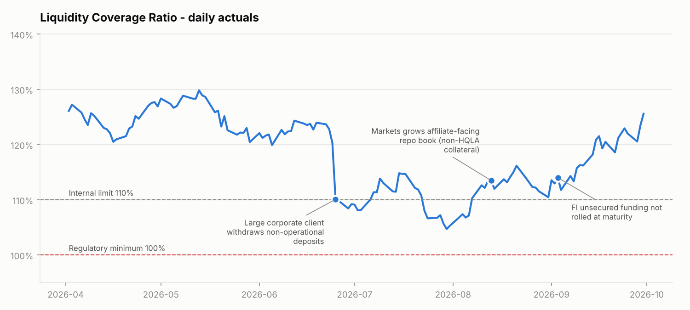
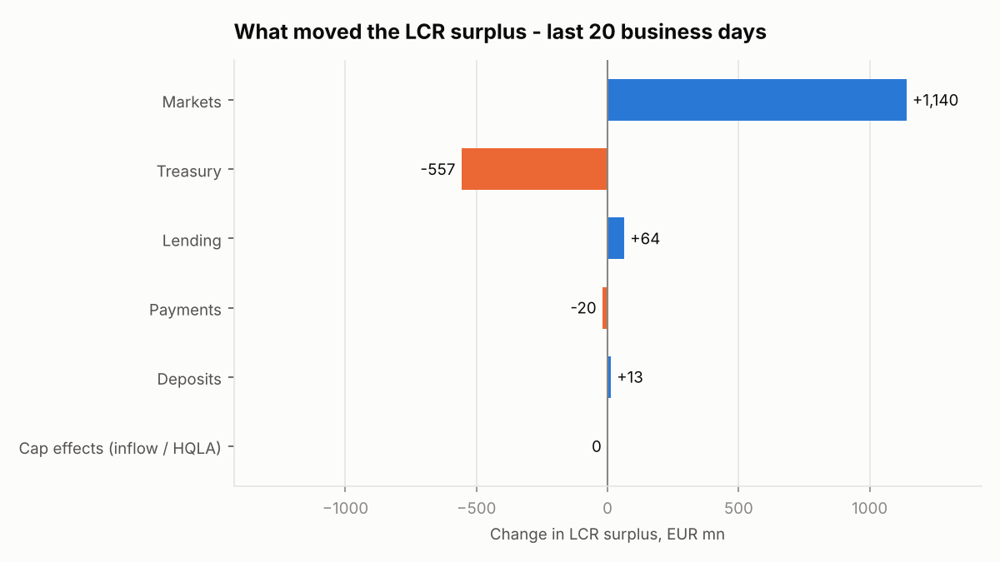
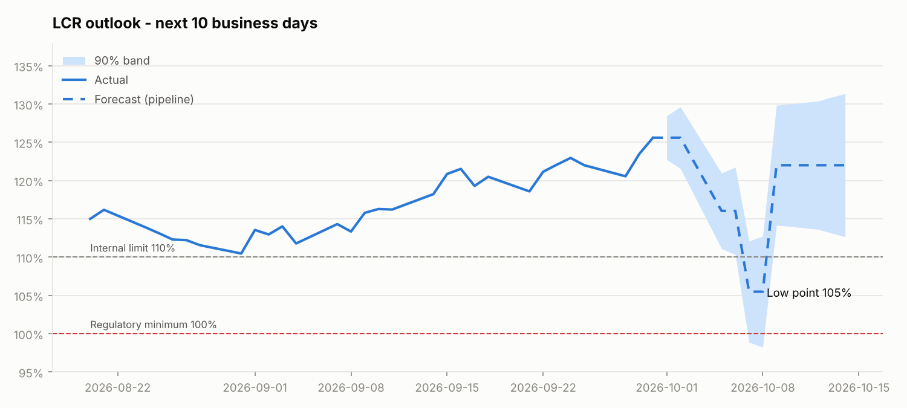

# Liquidity Monitor - LCR / NSFR analytics for a legal entity

A small Python toolkit that does what a Treasury analytics team does every day for a bank legal entity:

1. **Measures** the regulatory liquidity position - Liquidity Coverage Ratio (LCR) and Net Stable Funding Ratio (NSFR).
2. **Explains** it - attributes every move in the LCR surplus to the business line, product and counterparty type (third party vs affiliate) that caused it, beyond the headline daily number.
3. **Forecasts** it - projects the LCR over the next 10 business days using the known business pipeline (loan drawdowns, issuance, payment flows) with an uncertainty band.
4. **Reports** it - writes a short ALCO-style commentary for senior management.

All data is synthetic. Regulatory factors are a simplified version of Basel III (BCBS 238 / 295) and are for illustration only.

## Output







Example commentary ([full file](output/alco_commentary.md)):

> **LCR 126%** (within the 110% internal limit). Over the last 20 business days the surplus rose by EUR 0.64bn, driven mainly by Markets: FI unsecured funding that was not rolled removed a 100%-weighted outflow. Projected low point **LCR 105% on 07 Oct** on quarter-end corporate payment outflows - **below the internal limit** - recovering after the new 3y issuance settles.

## How it works

```
data/positions.csv  ──►  lcr.enrich()  ──►  lcr.aggregate()  ──►  daily LCR, surplus
  (daily balances by       row-level          caps applied:
   business / product /    HQLA value,        HQLA L2/L2B caps,
   counterparty)           outflow, inflow    75% inflow cap
         │
         ├──►  nsfr.compute()            ──►  ASF / RSF, NSFR
         ├──►  attribution.explain_move() ──►  drivers of surplus change (reconciles exactly)
         └──►  forecast.forecast_lcr()   ──►  10-day projection + pipeline + 90% band
                       ▲
data/pipeline.csv ─────┘  (known upcoming business events)
```

| Module | What it does |
|---|---|
| `liquidity_monitor/config.py` | HQLA haircuts, outflow / inflow rates, ASF / RSF factors, internal limits |
| `liquidity_monitor/data.py` | Synthetic balance sheet for one EU entity (assets, liabilities, off-balance commitments) with injected business events |
| `liquidity_monitor/lcr.py` | LCR engine: HQLA by level, composition caps, stressed outflows and capped inflows |
| `liquidity_monitor/nsfr.py` | NSFR engine: available vs required stable funding |
| `liquidity_monitor/attribution.py` | Surplus change by any dimension + volatility of liquidity usage by business |
| `liquidity_monitor/forecast.py` | Carry-forward + pipeline overlay + volatility band |
| `liquidity_monitor/commentary.py` | Senior-level Markdown summary |

### Attribution - the key idea

The daily surplus tells you *that* liquidity moved, not *why*. Each position contributes linearly to the uncapped surplus:

```
contribution = HQLA value - stressed outflow + stressed inflow
```

Summing the change in contribution by business / product / counterparty explains the move. The non-linear rules (inflow cap, HQLA caps) are shown as a separate "cap effects" line, so the attribution always **reconciles exactly** to the reported surplus change - this is enforced by a unit test.

A non-obvious example from the data: when Markets did not roll EUR 0.8bn of unsecured FI funding, cash fell by EUR 0.8bn but the **LCR went up**, because that funding carried a 100% stressed outflow. Attribution shows both legs separately instead of a misleading net zero.

## Run it

```bash
pip install -r requirements.txt
python run.py                # uses data/ if present
python run.py --regenerate   # rebuild the synthetic dataset
python -m pytest             # 8 tests: hand-checked LCR/NSFR, caps, reconciliation, forecast
```

Outputs land in `output/`: daily LCR/NSFR CSV, forecast CSV, attribution CSV, three charts and the commentary.

### Running on Databricks

The package is plain pandas, so it runs as-is in a Databricks notebook: upload the repo (Repos / Git folder), `%pip install -r requirements.txt`, then `from liquidity_monitor import lcr` and point it at a table with the same columns as `data/positions.csv` via `spark.table(...).toPandas()`.

## Simplifications (deliberate)

- One legal entity, one currency (EUR), no intraday view.
- LCR: no unwind of secured transactions in the HQLA cap formula; outflow/inflow buckets are a subset of the full rulebook.
- NSFR: maturity buckets are pre-assigned per product rather than derived from contractual cash flows.
- Forecast: flat carry-forward of BAU balances plus the explicit pipeline; no behavioural model.

## Possible extensions

- Internal stress scenarios (idiosyncratic / market-wide) with different run-off assumptions.
- Multi-entity view with intragroup flows netting out at consolidated level.
- Collateral view: encumbered vs unencumbered HQLA.
- SQL version of the engine on a warehouse table.
